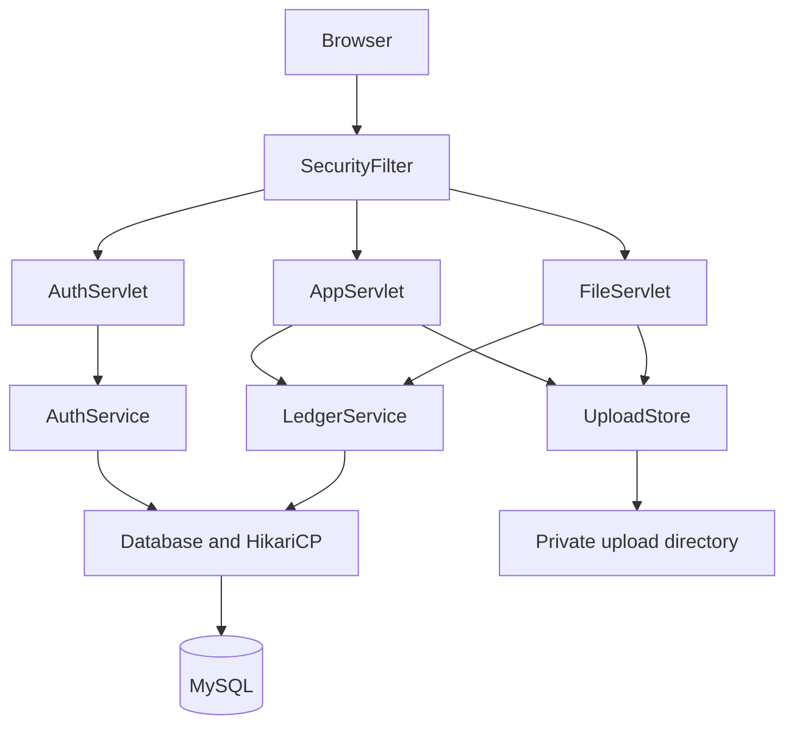
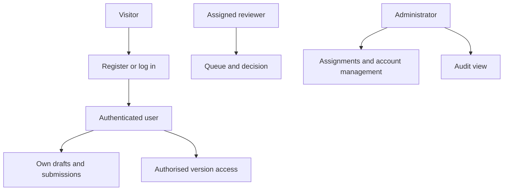
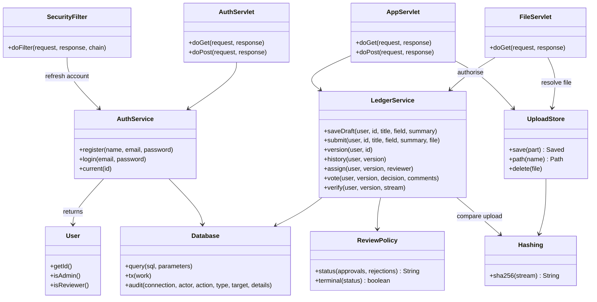
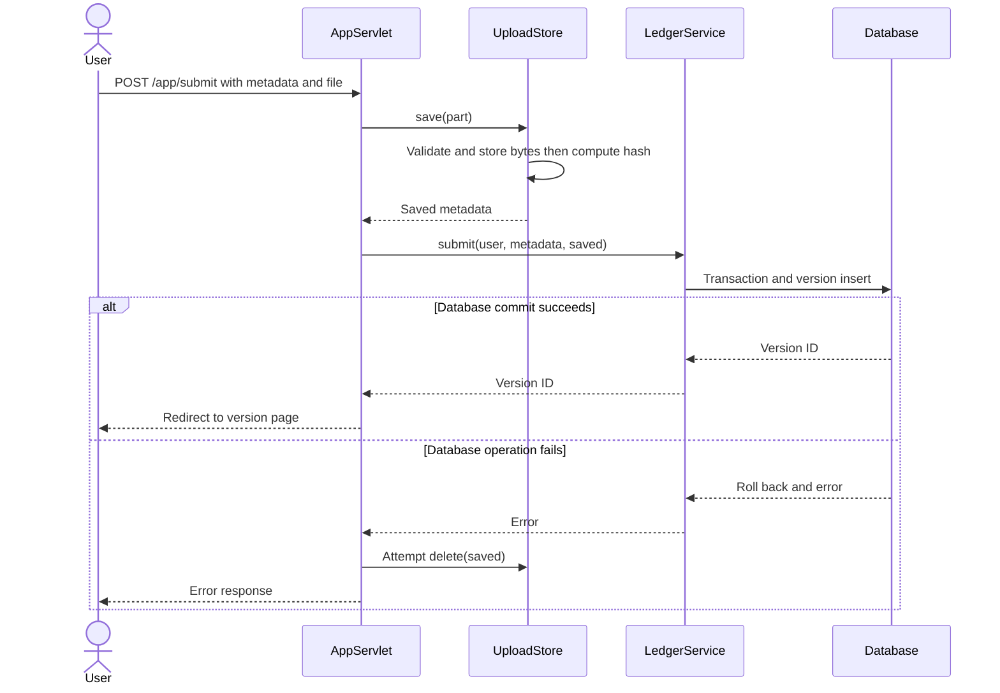
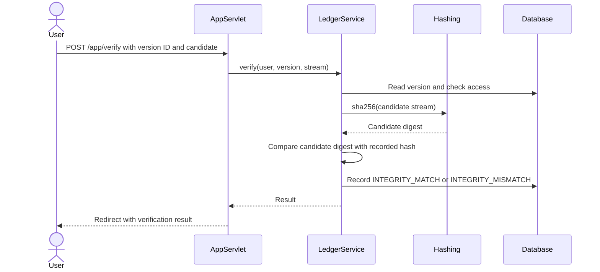
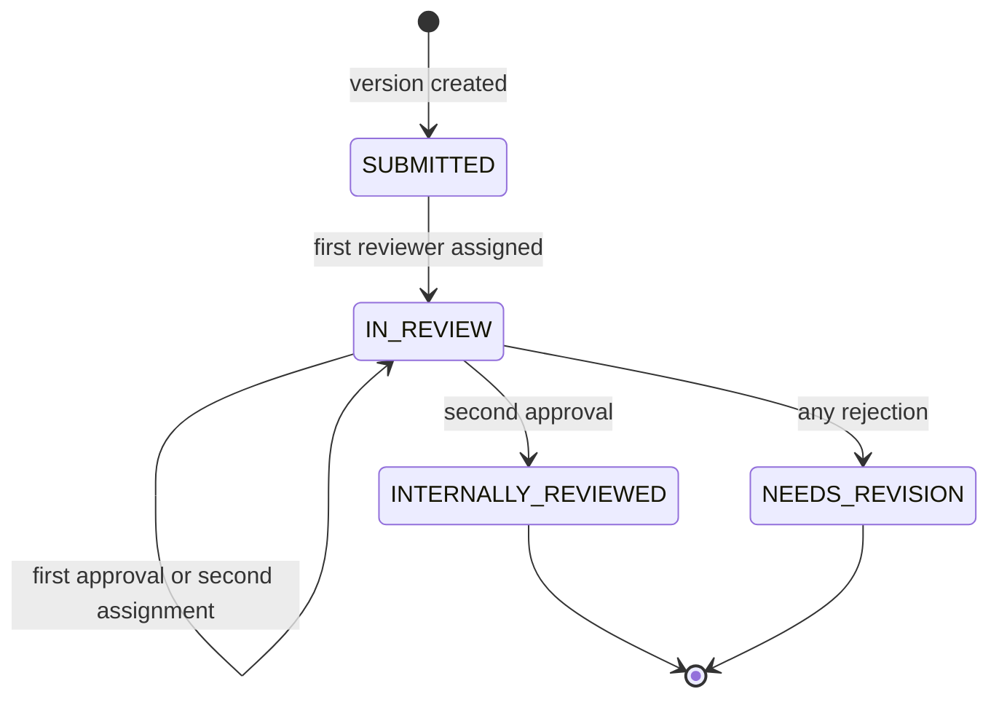
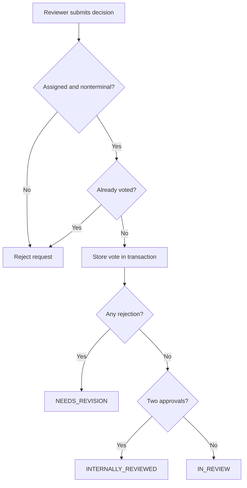
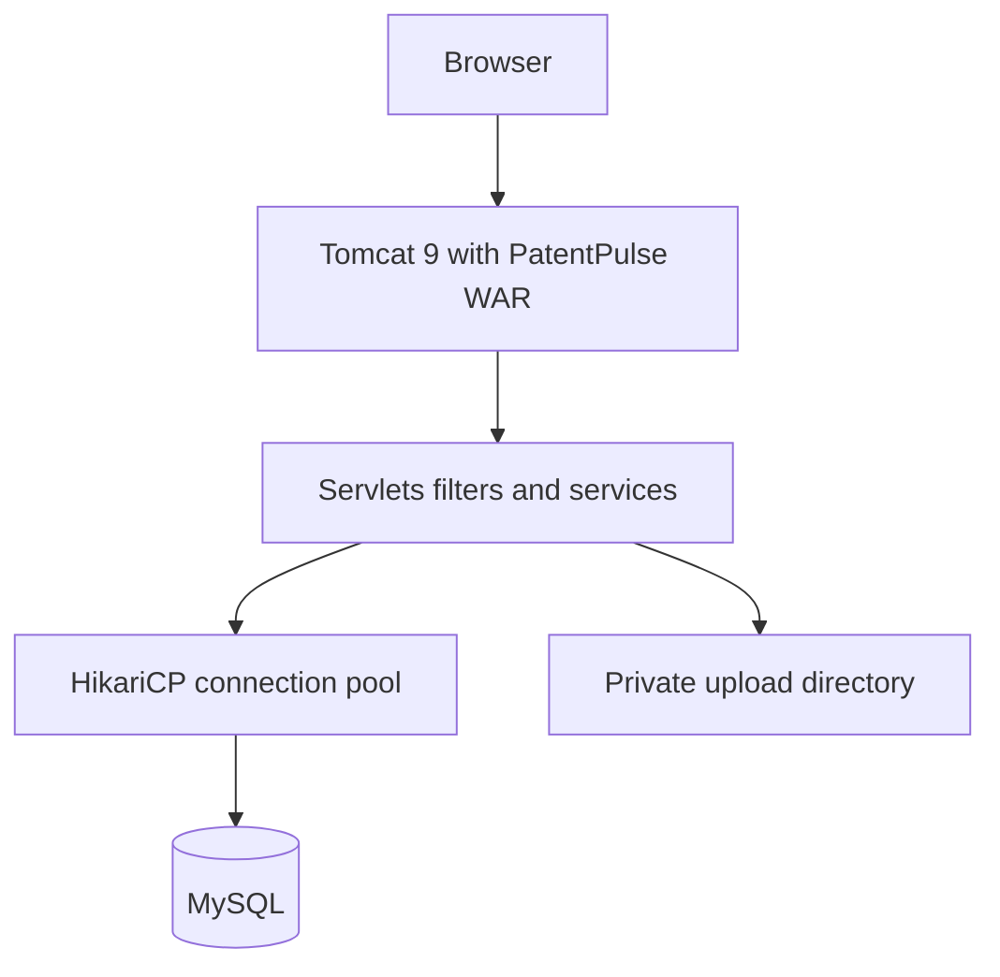
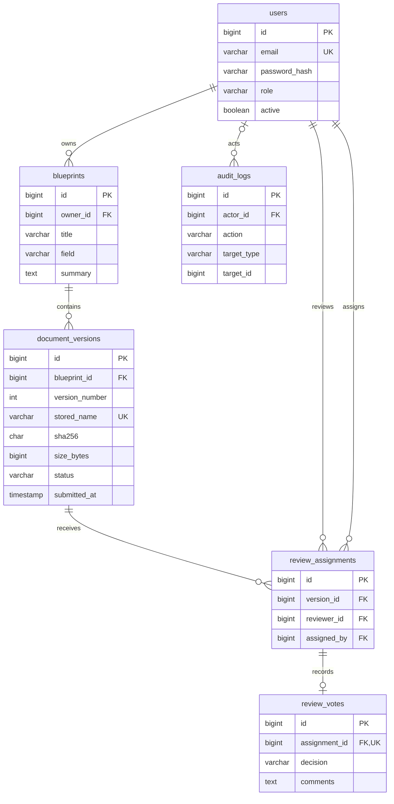

# PatentPulse — Research Document Management & Internal Review


**Keep research drafts, submitted versions, review decisions and file fingerprints together.**

[Repository](https://github.com/mohitsharma1305/PatentPulse) · [Quick start](#quick-start) · [Team](#team-members) · [UML](#week-5-uml-and-system-design) · [Deliverables](#week-12-report-presentation-and-final-demonstration)

> **Documentation baseline:** This README describes the supplied complete project archive. As inspected on 13 October 2026, `main` contains a partial source upload and is missing `pom.xml`, launch scripts and other application files. The full workflow below describes the supplied archive; this documentation update alone does not make the repository runnable. Week headings organise the agreed 12-week project phases; they are not a claim that work occurred on particular historical dates.

> **Deployment:** A local demo is available in the supplied source. No public deployment URL has been confirmed.

## Contents

- [Week 1 — Project administration and abstract](#week-1-project-administration-and-abstract)
- [Week 2 — Initial research and problem analysis](#week-2-initial-research-and-problem-analysis)
- [Week 3 — Security and patent background](#week-3-security-and-patent-background)
- [Week 4 — Requirements and architecture](#week-4-requirements-and-architecture)
- [Week 5 — UML and system design](#week-5-uml-and-system-design)
- [Week 6 — Database design and interface](#week-6-database-design-and-interface)
- [Weeks 7–10 — Module implementation](#weeks-710-module-implementation)
- [Week 11 — Integration and testing](#week-11-integration-and-testing)
- [Week 12 — Submission deliverables](#week-12-report-presentation-and-final-demonstration)
- [Quick start](#quick-start)
- [Source layout and Git workflow](#source-layout-and-git-workflow)

---

## Week 1: Project Administration and Abstract

### Project administration

| Detail | Information |
|---|---|
| Project | PatentPulse |
| Course | Advanced Java mini project |
| Programme | B.Tech Artificial Intelligence & Data Science, Semester V |
| Institution | Arya College of Engineering & IT, Jaipur |
| Academic session | 2026–27 |
| Project guide | To be added by the team |
| Team leader | Mohit Sharma |

### Team members

| Member | Module ownership | Module guide | Enrolment number |
|---|---|---|---|
| **Mohit Sharma** | Research drafts, uploads, version history and coordination | [Mohit](docs/modules/README_Mohit.md) | To be added |
| **Meet** | Login, registration, sessions and access control | [Meet](docs/modules/README_Meet.md) | To be added |
| **Jay** | SHA-256 generation, verification and downloads | [Jay](docs/modules/README_Jay.md) | To be added |
| **Nitesh** | Reviewer assignments, decisions and feedback | [Nitesh](docs/modules/README_Nitesh.md) | To be added |
| **Mann Jain** | Administration, audit logs and receipts | [Mann](docs/modules/README_Mann.md) | To be added |

Full names and enrolment numbers should be completed before submission.

### Abstract

Research files often move between personal folders, email attachments and revised copies. This makes it difficult to connect a review comment with the exact version that was submitted. PatentPulse provides an internal workspace where users save draft metadata, upload numbered file versions and view the decisions associated with each version.

The application uses Java 17, Servlets, JSP, JDBC and MySQL. Files are held in private storage, while the database records version metadata and a SHA-256 fingerprint. An authorised user can upload a candidate file and compare its fingerprint with the recorded value. Administrators assign reviewers, manage permitted account settings and inspect audit events. Two approvals complete an internal review; any rejection marks that version as needing revision.

PatentPulse supports traceability within a research team or institution. Its receipts and hashes are application records, not patent grants, digital signatures or independent proof of authorship.

## Week 2: Initial Research and Problem Analysis

### Problem statement

The application addresses four practical needs:

1. Keep drafts and submitted versions organised under one research item.
2. Preserve the metadata of the exact version reviewed.
3. Restrict access to owners, assigned reviewers and administrators.
4. Compare a candidate file with a recorded fingerprint and retain review feedback.

### Intended users and example

A researcher submits a report as version 1. An administrator assigns two reviewers. If a reviewer requests revision, the researcher uploads version 2. Version 1 keeps its own file details and decisions, while version 2 begins a separate review. The researcher can compare a local copy against either accessible version to check whether its SHA-256 fingerprint matches.

### Research approach

The project documentation covers document versioning, hashing, password protection, upload safety and patent-process boundaries. References appear in the accompanying paper draft. No user study, performance benchmark or exhaustive literature-review count is claimed.

## Week 3: Security and Patent Background

| Topic | Application behaviour or boundary |
|---|---|
| File integrity | SHA-256 compares candidate bytes with a saved digest. |
| Passwords | BCrypt protects stored passwords; file hashes are not used as password hashes. |
| Upload safety | Size limits, extension checks, basic content checks and generated storage names. |
| Access | Session authentication, role checks and version-specific permissions. |
| Request protection | POST operations require a session CSRF token. |
| Patent information | Internal approval does not determine patentability or grant legal rights. |
| Trust | Administrators and database operators remain trusted; there is no distributed ledger. |

Technical and background reading is listed in the [research-paper draft](reports/PatentPulse_Research_Paper_Draft.docx). Confidential research should follow the institution's disclosure policy.

## Week 4: Requirements and Architecture

### User roles

| Actor | Main functions |
|---|---|
| Visitor | Register or log in |
| Research owner | Save drafts, submit versions, search own records and inspect history |
| Assigned reviewer | Access assigned versions and submit one decision per assignment |
| Administrator | Assign reviewers, manage non-admin accounts and inspect audit events |
| Owner, assigned reviewer or administrator | View an authorised version, download, compare a candidate file and view its receipt |

The supplied implementation allows any authenticated role to use personal research routes. Those records remain owner-scoped.

### Main requirements

- Validate registration and rotate the session identifier after login.
- Accept supported nonempty uploads up to **10 MiB (10,485,760 bytes)**.
- Allocate a new version number and preserve each submission's metadata snapshot.
- Assign at most two distinct active reviewers; prevent self-review and duplicate assignments.
- Apply `INTERNALLY_REVIEWED` after two approvals or `NEEDS_REVISION` after any rejection.
- Record relevant state changes and verification outcomes in the audit log.
- Generate a printable receipt from the selected version.

See the [complete SRS](reports/PatentPulse_SRS.docx) for functional requirements and acceptance checks.

### Architecture



JSP pages render the interface. Servlets handle requests, services apply business rules and the Database helper executes prepared JDBC operations. The local demo uses H2 and embedded Tomcat.

## Week 5: UML and System Design

### Use cases

| Actor | Main use cases |
|---|---|
| Visitor | Register, log in |
| Authenticated user | Maintain own drafts, submit versions, list own research |
| Owner, assigned reviewer or admin | View authorised version, compare candidate file, download, view receipt |
| Reviewer | View assigned queue, submit one decision per assignment |
| Admin | Assign reviewers, manage non-admin accounts, inspect audit events |

Current personal research routes accept any authenticated role and remain owner-scoped. Restricting creation to researchers only is not enforced by an additional role check in the supplied baseline.



### Class diagram

Method lists are selective; they do not reproduce every helper or constructor. Persistence records other than User are represented by maps in the Java implementation, not invented entity classes.



### Submission sequence

The filter has authenticated the request and checked the POST token before this sequence begins. File validation failure ends before persistence. Database failure triggers attempted file cleanup.



### Verification sequence



### Version state diagram

Draft describes a parent research item before its first version, and is not stored in document_versions.status. Each new version starts at SUBMITTED. A terminal version never returns to an earlier state.



### Review activity view



### Deployment view



The local demo substitutes embedded Tomcat and H2. Public TLS termination and backup infrastructure are deployment responsibilities and are not supplied as application services.


Formal use-case source: [PlantUML](docs/uml/use-cases.puml). Full design guide: [UML README](docs/uml/README.md).

## Week 6: Database Design and Interface

### Database tables

| Table | Purpose | Important relationship |
|---|---|---|
| `users` | Accounts, password hashes, roles and active status | Owns research; may review or assign |
| `blueprints` | Parent research metadata | Belongs to an owner |
| `document_versions` | File metadata, digest, snapshot and review status | Belongs to a research item |
| `review_assignments` | Reviewer allocation | Connects a reviewer to a version |
| `review_votes` | Decision and feedback | At most one vote per assignment |
| `audit_logs` | Application event records | May reference an actor and a target |

The files stay in private filesystem storage. There is no separate receipts table. Draft means a research item without a submitted version.

### Entity relationship diagram



Additional constraints: (blueprint_id, version_number) and (version_id, reviewer_id) are unique. The two-reviewer limit is implemented in the service, not by an ER cardinality constraint. audit_logs.target_id is a polymorphic reference and has no declared foreign key. A receipt is a view of a version.

### Interface screenshots

The following are supplied local-demo screenshots using synthetic research data.

<details>
<summary>Login and registration</summary>


</details>

<details>
<summary>Research dashboard</summary>


</details>

<details>
<summary>Version details, file verification and history</summary>


</details>

## Weeks 7–10: Module Implementation

These phases cover development across the five modules. The table is an implementation plan, not a retrospective activity record.

| Phase | Focus |
|---|---|
| Week 7 | Account/session foundations, drafts and upload storage |
| Week 8 | Hash comparison, downloads and version-history integration |
| Week 9 | Reviewer allocation, decisions and status transitions |
| Week 10 | Account administration, audit records, receipts and module integration |

### Mohit: Module ownership

#### Research drafts uploads and version history

Saving metadata creates a draft. Submission writes the file and inserts a metadata snapshot with a new version number. Later submissions preserve old snapshots. AppServlet attempts storage cleanup when submission persistence fails.

#### Files and responsibility

| Project path | Responsibility |
|---|---|
| `src/main/java/com/patentpulse/service/UploadStore.java` | File validation, safe storage and cleanup. Shared with Jay for hashing. |
| `src/main/webapp/WEB-INF/views/editor.jsp` | Draft, upload and submission form. |
| `src/main/webapp/WEB-INF/views/dashboard.jsp` | Own research listing, search and status filtering. |
| `src/main/webapp/WEB-INF/views/document.jsp` | Research details and version-history section. Shared with Jay and Nitesh. |
| `src/main/java/com/patentpulse/service/LedgerService.java` | mine, draft, saveDraft, submit, validate and history. Shared with all five. |
| `src/main/java/com/patentpulse/web/AppServlet.java` | Dashboard, editor, draft and submission routes. Shared with Jay, Nitesh and Mann. |

#### Routes

GET /app/dashboard, GET /app/new, POST /app/draft, POST /app/submit, GET /app/document

#### Data

blueprints and document_versions

#### Shared coordination

Meet supplies the current session user; Jay owns SHA-256 implementation; Nitesh adds review sections; Mann uses version data for receipts. Mohit coordinates root build files, schemas and shared assets.

#### Acceptance checks

1. Create a draft, reopen it and confirm its owner-scoped fields.
2. Submit a supported file and inspect stored metadata.
3. Reject empty, oversized and unsupported files.
4. Submit a second version and confirm the earlier snapshot still exists.
5. Verify another user cannot edit the record.

These are checks to run, not fresh passing results. Use the final merged source and record actual output.


### Meet: Module ownership

#### Authentication sessions and access control

Registration forces RESEARCHER. Registered passwords use BCrypt cost 12. Login rotates session ID and CSRF token. Sessions expire after 30 minutes. The filter refreshes account role and active status on requests.

#### Files and responsibility

| Project path | Responsibility |
|---|---|
| `src/main/java/com/patentpulse/web/AuthServlet.java` | Login, registration, logout, session rotation and session-scoped delay. |
| `src/main/java/com/patentpulse/service/AuthService.java` | Account validation, BCrypt and active-user lookup. |
| `src/main/java/com/patentpulse/web/SecurityFilter.java` | Route checks, CSRF, response headers and current-account refresh. |
| `src/main/java/com/patentpulse/model/User.java` | Session identity and role helpers. |
| `src/main/webapp/WEB-INF/views/auth.jsp` | Login and registration UI. |
| `src/main/webapp/WEB-INF/views/csrf.jspf` | CSRF hidden-field fragment. |
| `src/main/java/com/patentpulse/service/LedgerService.java` | Coordinate service-level role and ownership checks with all owners. |

#### Routes

GET/POST /login, GET/POST /register, POST /logout; filter mapped to /*

#### Data

users, shared with Mann

#### Shared coordination

Coordinate users-table fields and account-state changes with Mann. Every module still needs per-record service authorisation. The one-minute delay after five failures is session-scoped, not account-wide.

#### Acceptance checks

1. Register normally and attempt to submit an elevated role.
2. Check duplicate email and invalid credentials.
3. Check login/logout and protected access after logout.
4. Send a POST without the CSRF token.
5. Deactivate an account through admin and inspect its later access.

These are checks to run, not fresh passing results. Use the final merged source and record actual output.


### Jay: Module ownership

#### File hashing verification and downloads

UploadStore hashes a stored submission. Verification hashes a separate candidate stream and compares it to the selected version. Download checks authorisation and file existence, then streams the stored bytes. It does not automatically rehash the stored file.

#### Files and responsibility

| Project path | Responsibility |
|---|---|
| `src/main/java/com/patentpulse/util/Hashing.java` | Streaming SHA-256 utility. |
| `src/main/java/com/patentpulse/web/FileServlet.java` | Authorised attachment download. |
| `src/test/java/com/patentpulse/HashingTest.java` | Known vectors, changed bytes, empty stream and read boundaries. |
| `src/main/java/com/patentpulse/service/LedgerService.java` | verify and the stored-hash comparison. Shared with all five. |
| `src/main/java/com/patentpulse/service/UploadStore.java` | Upload-time hash integration, shared with Mohit. |
| `src/main/java/com/patentpulse/web/AppServlet.java` | POST /verify handling, shared with Mohit, Nitesh and Mann. |
| `src/main/webapp/WEB-INF/views/document.jsp` | Hash display, verification result and download link, shared with Mohit and Nitesh. |

#### Routes

POST /app/verify and GET /file?id=<version-id>

#### Data

document_versions.sha256, stored_name, original_name and size_bytes; verification audit events

#### Shared coordination

Coordinate storage and upload cleanup with Mohit, access checks with Meet and verification audit records with Mann. Hashing is not encryption or legal proof. Do not claim automatic corrupted-download blocking without implementing and testing it.

#### Acceptance checks

1. Run HashingTest and retain observed results.
2. Compare the original sample and expect MATCH.
3. Compare the altered sample and expect MISMATCH.
4. Check that unauthorised version identifiers cannot be downloaded.
5. Check missing stored-file handling.

These are checks to run, not fresh passing results. Use the final merged source and record actual output.


### Nitesh: Module ownership

#### Reviewer assignments decisions and feedback

Admins assign up to two distinct active reviewers. Self-review is rejected. Each assignment accepts one vote. Any rejection closes the version as NEEDS_REVISION; two approvals produce INTERNALLY_REVIEWED. Comments require 10–3000 characters under the source validation rules.

#### Files and responsibility

| Project path | Responsibility |
|---|---|
| `src/main/java/com/patentpulse/service/ReviewPolicy.java` | Status calculation and terminal-state helper. |
| `src/main/webapp/WEB-INF/views/queue.jsp` | Reviewer and administrator queue. |
| `src/test/java/com/patentpulse/ReviewPolicyTest.java` | Threshold, rejection and terminal-state tests. |
| `src/main/java/com/patentpulse/service/LedgerService.java` | reviews, queue, reviewers, assign, lockVersion and vote. Shared with all five. |
| `src/main/java/com/patentpulse/web/AppServlet.java` | Queue, assignment and decision routes, shared with Mohit, Jay and Mann. |
| `src/main/webapp/WEB-INF/views/document.jsp` | Assignment controls, decision form and feedback. Shared with Mohit and Jay. |

#### Routes

GET /app/review, GET /app/admin/queue, POST /app/admin/assign, POST /app/review/vote

#### Data

review_assignments, review_votes and document_versions.status

#### Shared coordination

Although admins use assignment controls, this development feature belongs to Nitesh. Coordinate version IDs with Mohit, permission checks with Meet and audit events with Mann.

#### Acceptance checks

1. Reject duplicate, third and self-review assignments.
2. Confirm one approval leaves IN_REVIEW.
3. Confirm two approvals finish the review.
4. Confirm any rejection requires a new revision.
5. Reject duplicate votes and decisions on terminal versions.

These are checks to run, not fresh passing results. Use the final merged source and record actual output.


### Mann: Module ownership

#### Administration audit and receipts

Admins can update non-admin researcher/reviewer accounts. Existing admin accounts cannot be changed through this page. Unfinished active reviewer assignments block deactivation or demotion. The audit view shows the latest 200 events. Receipts read version data and have no separate table.

#### Files and responsibility

| Project path | Responsibility |
|---|---|
| `src/main/webapp/WEB-INF/views/users.jsp` | Role and active-status administration UI. |
| `src/main/webapp/WEB-INF/views/audit.jsp` | Latest audit event display. |
| `src/main/webapp/WEB-INF/views/receipt.jsp` | Printable submission receipt. |
| `src/main/java/com/patentpulse/service/LedgerService.java` | users, changeUser and audit. Shared with all five. |
| `src/main/java/com/patentpulse/dao/Database.java` | Audit insertion and shared JDBC helpers. Coordinate all schema impacts. |
| `src/main/java/com/patentpulse/web/AppServlet.java` | User administration, audit and receipt routes, shared with Mohit, Jay and Nitesh. |

#### Routes

GET /app/admin/users, POST /app/admin/user, GET /app/admin/audit, GET /app/receipt

#### Data

users and audit_logs; read document_versions and blueprints for receipts

#### Shared coordination

Coordinate account semantics with Meet, receipt version data with Mohit and review-related events with Nitesh. Receipts are unsigned and do not grant patent rights. Database operators can alter audit data; append-only or tamper-proof storage is not implemented.

#### Acceptance checks

1. Reject admin routes for ordinary users.
2. Change an eligible user role and active flag.
3. Reject edits to admin accounts.
4. Check unfinished-reviewer protection.
5. Inspect audit ordering and authorised receipt access.

These are checks to run, not fresh passing results. Use the final merged source and record actual output.


### Existing administration view

The administrator user-management view is `src/main/webapp/WEB-INF/views/users.jsp`, with styles in `src/main/webapp/assets/admin-users.css`. It displays account roles and status, allows researcher/reviewer role and activation changes, and shows administrator accounts as protected.

### Shared-file coordination

| Shared file | Members coordinating changes |
|---|---|
| `LedgerService.java` | Mohit, Meet, Jay, Nitesh and Mann |
| `AppServlet.java` | Mohit, Jay, Nitesh and Mann |
| `document.jsp` | Mohit, Jay and Nitesh |
| `UploadStore.java` | Mohit and Jay |
| `Database.java` and schema files | Mann and members affected by database changes |

Shared means several modules use sections of one file. It does not mean each member should upload a separate full copy over the others' changes.

## Week 11: Integration and Testing

### Available test evidence

The supplied archive's `docs/TEST-REPORT.md` records **11 passing tests** on **6 October 2026**. These are archived results, not a fresh run on the current GitHub branch.

| Suite | Test methods | Scope |
|---|---:|---|
| `HashingTest` | 4 | Digest behaviour and stream cases |
| `ReviewPolicyTest` | 4 | Approval, rejection and terminal-state rules |
| `WorkflowTest` | 3 | Connected HTTP/JSP application workflows |

### Integration checks by member

| Member | Checks to run on the final branch |
|---|---|
| Mohit | Draft persistence, invalid uploads and separate version snapshots |
| Meet | Registration, login/logout, CSRF and unauthorised route access |
| Jay | Original-file match, changed-file mismatch and authorised downloads |
| Nitesh | Duplicate/self assignments, two approvals, rejection and repeat-vote blocking |
| Mann | Account restrictions, audit events and version receipts |

### Integration risks and handling

| Risk to check | Handling |
|---|---|
| Conflicting edits in shared files | Update from main, review diffs and merge through pull requests. |
| Database failure after file storage | Controller attempts file cleanup; crash recovery requires separate operational handling. |
| Incompatible servlet container | Use the supplied javax.servlet baseline with Tomcat 9. |
| Incorrect database configuration | Set actual environment variables; the application does not automatically load `.env`. |
| Demo succeeds but deployment differs | Repeat checks on MySQL and external Tomcat. |

These are risks and checks, not claims of incidents the team experienced.

```sh
mvn clean verify
```

Record the tested commit, Java/Maven versions and actual build output. No latency benchmark, load-test result or independent security audit has been supplied.

## Week 12: Report, Presentation and Final Demonstration

| Deliverable | Resource | Status |
|---|---|---|
| Project report | [Word document](reports/PatentPulse_Project_Report.docx) | Prepared; team details to complete |
| Research paper | [Paper draft](reports/PatentPulse_Research_Paper_Draft.docx) | Unpublished design and implementation draft |
| SRS | [Requirements](reports/PatentPulse_SRS.docx) | Prepared |
| Presentation | [13-slide PPT](reports/PatentPulse_Presentation.pptx) | Prepared |
| UML design | [Design README](docs/uml/README.md) | Prepared |
| Module guides | [All five members](docs/modules/README.md) | Prepared |
| Weekly report | [Weeks 1–12](reports/Weekly_Report_Weeks_1_to_12.md) · [Excel](reports/excel/PatentPulse_12_Week_Report.xlsx) | Draft entries to confirm |
| Leader daily report | [Mohit's Excel](reports/excel/Mohit_PatentPulse_84_Day_Report.xlsx) | Draft entries to confirm |
| Demo video | [Recording script](docs/DEMO_VIDEO_SCRIPT.md) | Recording pending |

These relative links use the supplied documentation-pack layout. Upload the matching `docs/` and `reports/` files alongside this README for the links to work on GitHub.

### Suggested demonstration

1. Log in and save a research draft.
2. Submit a sample file and show its version, digest and receipt.
3. Compare the original file, then an altered file.
4. Assign reviewers and demonstrate a review decision.
5. Submit a revised version and show preserved history.
6. Show permitted account management and audit events.

## Quick Start

Clone the existing repository:

```sh
git clone https://github.com/mohitsharma1305/PatentPulse.git
cd PatentPulse
```

The source files, `pom.xml` and launch scripts must be present. If the team has not yet committed them, add the reviewed source before running these commands.

Prerequisites: JDK 17, Maven and the supplied project source. Run commands from the directory containing `pom.xml`.

Windows demo:
```bat
java -version
mvn -version
START-DEMO.bat
```

Linux/macOS demo:
```sh
chmod +x START-DEMO.sh
./START-DEMO.sh
```

Open `http://localhost:8080/patentpulse`. The initial run downloads dependencies. Keep the terminal open and stop with Ctrl+C. If port 8080 is busy:
```sh
mvn test-compile exec:java -Dexec.mainClass=com.patentpulse.DemoServer -Dexec.classpathScope=test -Ddemo.port=8081
```

The local demo supplies `researcher@demo.local`, `reviewer1@demo.local`, `reviewer2@demo.local` and `admin@demo.local`, using `PatentPulse!2026`. These are synthetic demo accounts. Keep demo mode disabled in a real installation.

## Build and database deployment

```sh
mvn clean verify
```

The WAR is `target/patentpulse.war`. Use a compatible Tomcat 9 installation for the supplied `javax.servlet` application. MySQL setup is in `sql/create-database.sql` and `sql/schema.sql`. Set actual environment variables based on `config.example.env`: `DB_URL`, `DB_USER`, `DB_PASSWORD`, `UPLOAD_DIR`, `INIT_SCHEMA`, `DEMO_MODE` and the first-admin bootstrap settings. The application does not automatically read `.env` files.

Configure a private upload directory and bootstrap the first admin. Remove bootstrap credentials afterwards. Review dependency patch levels and deployment controls before public hosting. The archive's dependency versions are a reproducibility baseline, not a claim that they are the newest secure releases.

## Source Layout and Git Workflow

| Location | Purpose |
|---|---|
| `src/main/java/com/patentpulse/config/` | Startup, configuration and connection-pool lifecycle |
| `src/main/java/com/patentpulse/dao/` | Prepared JDBC operations and transactions |
| `src/main/java/com/patentpulse/model/` | Session user model |
| `src/main/java/com/patentpulse/service/` | Accounts, research workflows, review rules and storage |
| `src/main/java/com/patentpulse/util/` | Hashing and application errors |
| `src/main/java/com/patentpulse/web/` | Servlet controllers and security filter |
| `src/main/webapp/WEB-INF/views/` | JSP pages and shared fragments |
| `src/main/webapp/assets/` | Styles and JavaScript |
| `src/main/resources/schema.sql` | Application schema initialisation |
| `src/test/java/com/patentpulse/` | Tests and demo server |
| `sql/` | MySQL database setup |
| `samples/` | Synthetic demonstration files |

## Team workflow

Pull current main before starting a branch. Stage exact assigned files, describe actual changes in the commit, and open a pull request. Coordinate changes in `LedgerService.java`, `AppServlet.java`, `document.jsp`, `UploadStore.java` and `Database.java`. Member-name folders in the earlier distribution pack are wrappers, not repository directories.

Do not commit local database files, uploads, secrets, `target/` or a Maven installation. Rebuild the WAR after source changes.

### Contributing to the existing repository

```sh
git switch main
git pull --ff-only origin main
git switch -c docs/patentpulse-readme
```

Edit the agreed files, inspect `git diff`, and stage exact paths. For a README-only update:

```sh
git add README.md
git commit -m "docs: expand PatentPulse overview and module documentation"
git push -u origin docs/patentpulse-readme
```

Open a pull request into `main`. Commit the linked documentation separately if it is not already present. Preserve existing team changes and do not force-push shared history.

## Scope and Current Limitations

- Verification compares an uploaded candidate with a saved digest. Downloads do not automatically rehash the stored file.
- SHA-256 does not establish originality, patentability or ownership.
- Receipts are unsigned application records; there is no independent timestamp service.
- Upload checks do not include antivirus scanning.
- Failed-login throttling is session-scoped.
- Public hosting, a fresh final-branch test run and the demo video remain to be verified or completed.

Guide details, enrolment numbers and confirmed activity records should be completed before academic submission.
