# PatentPulse: Research Document Management, File Verification & Internal Review Portal


> **Project Repository:** [mohitsharma1305/PatentPulse](https://github.com/mohitsharma1305/PatentPulse)
>
> **Local Demonstration:** `http://localhost:8080/patentpulse` after starting the demo server.

> [!IMPORTANT]
> ### 🔑 Default Login Credentials for Local Testing & Evaluation
> These synthetic accounts are available in demo mode. They are not production credentials.
>
> | Persona / Role | Email | Password | Access & Privileges |
> | :--- | :--- | :--- | :--- |
> | **Administrator** | `admin@demo.local` | `PatentPulse!2026` | Assign reviewers, manage eligible accounts and inspect audit events. |
> | **Researcher** | `researcher@demo.local` | `PatentPulse!2026` | Save drafts, submit versions, view history and verify files. |
> | **Reviewer 1** | `reviewer1@demo.local` | `PatentPulse!2026` | Access assigned documents and record a decision. |
> | **Reviewer 2** | `reviewer2@demo.local` | `PatentPulse!2026` | Provide a second independent review when assigned. |
>
> Run `START-DEMO.bat` on Windows or `sh START-DEMO.sh` on Linux/macOS with JDK 17 and Maven installed.

---

## Week 1: Project Administration & Abstract

### Project administration

| Detail | Information |
|---|---|
| Project | PatentPulse |
| Course | Advanced Java mini project |
| Programme | B.Tech Artificial Intelligence & Data Science, Semester V |
| Institution | Arya College of Engineering & IT, Jaipur |
| Academic session | 2026–27 |
| Project guide | Er. Ram Babu Buri Sir |
| Team leader | Mohit Sharma |

### Team members

| Member | Module ownership | RTU Roll no. | Enrolment number |
|---|---|---|---|
| **Mohit Sharma** | Research drafts, uploads, version history and coordination | 24EARAD104 | 24E1ARADM40P104 |
| **Meet** | Login, registration, sessions and access control | 24EARAD101 | 24E1ARADM30P101 |
| **Jay** | SHA-256 generation, verification and downloads | 24EARAD068 | 24E1ARADM40P068 |
| **Nitesh** | Reviewer assignments, decisions and feedback | 24EARAD114 | 24E1ARADM30P114 |
| **Mann Jain** | Administration, audit logs and receipts | 24EARAD092 | 24E1ARADM30P092 |


### Abstract

Research files often move between personal folders, email attachments and revised copies. This makes it difficult to connect a review comment with the exact version that was submitted. PatentPulse provides an internal workspace where users save draft metadata, upload numbered file versions and view the decisions associated with each version.

The application uses Java 17, Servlets, JSP, JDBC and MySQL. Files are held in private storage, while the database records version metadata and a SHA-256 fingerprint. An authorised user can upload a candidate file and compare its fingerprint with the recorded value. Administrators assign reviewers, manage permitted account settings and inspect audit events. Two approvals complete an internal review; any rejection marks that version as needing revision.

PatentPulse supports traceability within a research team or institution. Its receipts and hashes are application records, not patent grants, digital signatures or independent proof of authorship.

---

## Week 2: User Roles, SRS & System Architecture

### User roles

| Actor | Main functions |
|---|---|
| Visitor | Register or log in |
| Research owner | Save drafts, submit versions, search own records and inspect history |
| Assigned reviewer | Access assigned versions and submit one decision per assignment |
| Administrator | Assign reviewers, manage non-admin accounts and inspect audit events |
| Owner, assigned reviewer or administrator | View an authorised version, download, compare a candidate file and view its receipt |


### Main requirements

- Validate registration and rotate the session identifier after login.
- Accept supported nonempty uploads up to **10 MiB (10,485,760 bytes)**.
- Allocate a new version number and preserve each submission's metadata snapshot.
- Assign at most two distinct active reviewers; prevent self-review and duplicate assignments.
- Apply `INTERNALLY_REVIEWED` after two approvals or `NEEDS_REVISION` after any rejection.
- Record relevant state changes and verification outcomes in the audit log.
- Generate a printable receipt from the selected version.

See the [complete SRS](https://drive.google.com/file/d/12Y_sHfc7zVybGAvwn7ySOf90QEhWdJwl/view?usp=sharing) for functional requirements and acceptance checks.

### Architecture

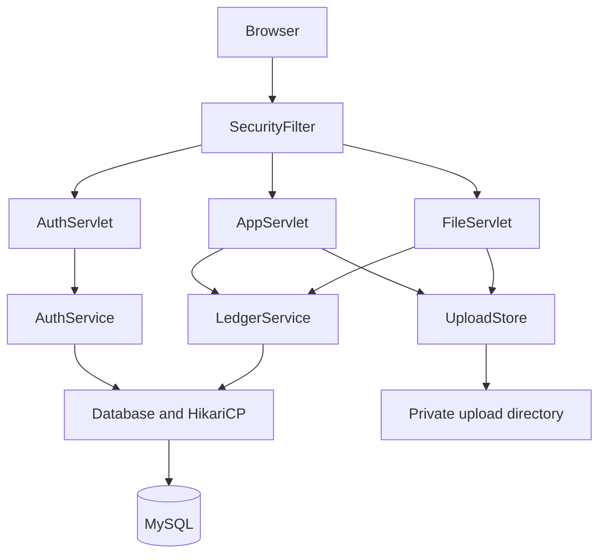

JSP pages render the interface. Servlets handle requests, services apply business rules and the Database helper executes prepared JDBC operations. The local demo uses H2 and embedded Tomcat.

### Functional Modules

| Module | Member | Main Responsibility |
| :--- | :--- | :--- |
| Module 1 | Mohit Sharma | Drafts, uploads, version history and project coordination |
| Module 2 | Meet | Login, registration, sessions and access control |
| Module 3 | Jay | SHA-256, file verification and downloads |
| Module 4 | Nitesh | Reviewer assignments, decisions and feedback |
| Module 5 | Mann Jain | Administration, audit events and receipts |

### Relational Database Strategy

- **Prepared JDBC operations:** Database helpers bind parameters for application queries and updates.
- **Connection management:** HikariCP manages the connection pool and the application listener closes it at shutdown.
- **Transactional workflows:** Related database operations use transactions. Files are stored separately in a private directory.
- **Version identity:** Unique research/version and version/reviewer pairs prevent duplicated numbering and assignment records.
- **Demonstration database:** H2 supports the embedded local demo and automated workflows; MySQL is the configured external database.

### Non-Functional Requirements

| Requirement | Implementation or Evaluation Boundary |
| :--- | :--- |
| Security | BCrypt passwords, session checks, CSRF tokens and per-record authorisation |
| Upload handling | Supported formats, nonempty files, 10 MiB maximum, generated storage names |
| Maintainability | Servlets, services, database helpers, JSP views and tests have separate responsibilities |
| Portability | Java 17 / Servlet 4.0 baseline with Tomcat 9; environment-based configuration |
| Reliability | Database transactions and attempted cleanup of files after failed submissions |
| Performance | Streaming hashing and pooled database connections; no measured latency or load-test claim |

---

## Week 3: UML Architecture & System Design

The diagrams describe the current source structure, request flows, version states and database relationships.

### Use cases

| Actor | Main use cases |
|---|---|
| Visitor | Register, log in |
| Authenticated user | Maintain own drafts, submit versions, list own research |
| Owner, assigned reviewer or admin | View authorised version, compare candidate file, download, view receipt |
| Reviewer | View assigned queue, submit one decision per assignment |
| Admin | Assign reviewers, manage non-admin accounts, inspect audit events |

Current personal research routes accept any authenticated role and remain owner-scoped. Restricting creation to researchers only is not enforced by an additional role check in the supplied baseline.

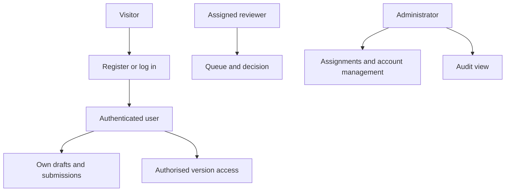

### Class diagram

Method lists are selective; they do not reproduce every helper or constructor. Persistence records other than User are represented by maps in the Java implementation, not invented entity classes.

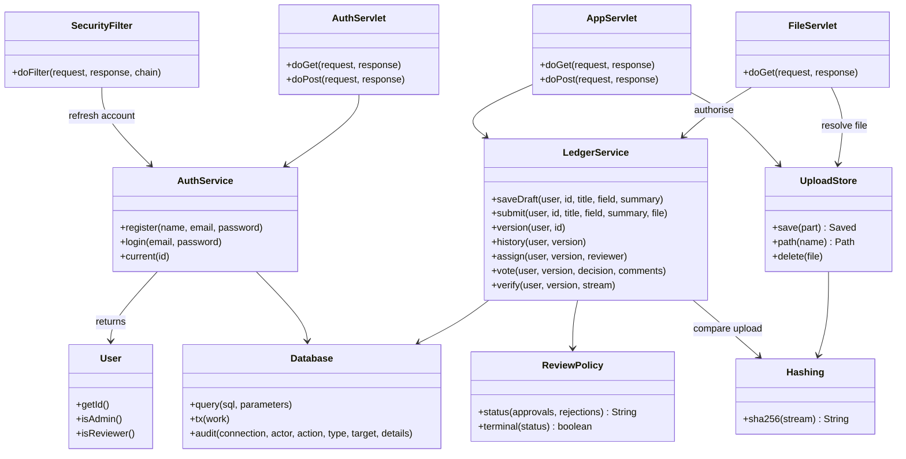

### Submission sequence

The filter has authenticated the request and checked the POST token before this sequence begins. File validation failure ends before persistence. Database failure triggers attempted file cleanup.

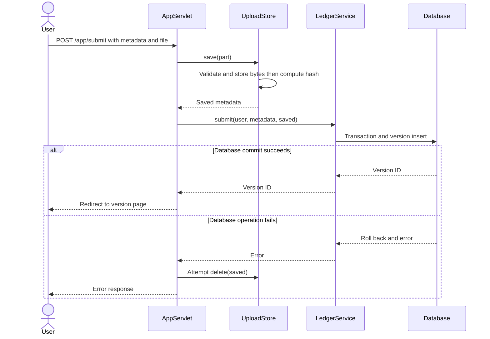

### Verification sequence

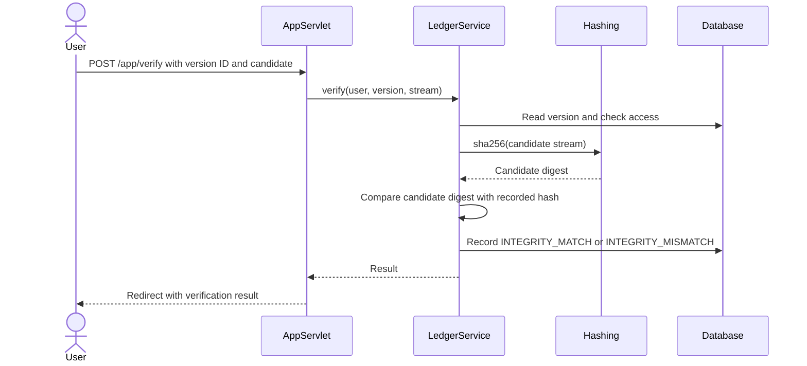

### Version state diagram

Draft describes a parent research item before its first version, and is not stored in document_versions.status. Each new version starts at SUBMITTED. A terminal version never returns to an earlier state.

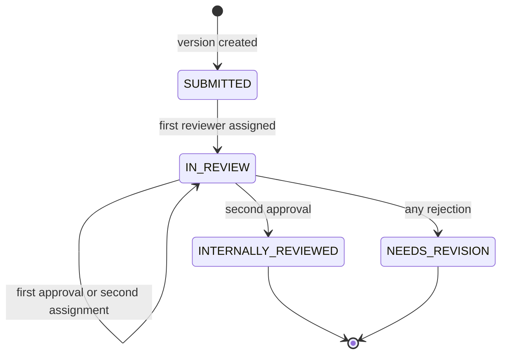

### Review activity view

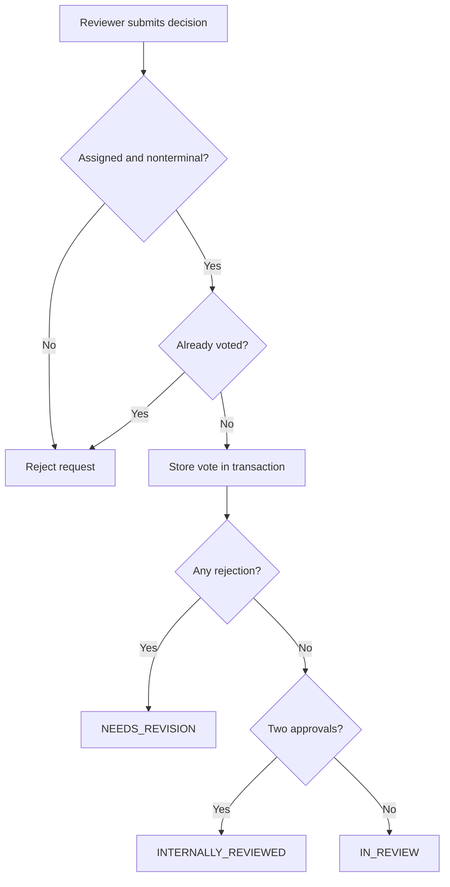

### Deployment view

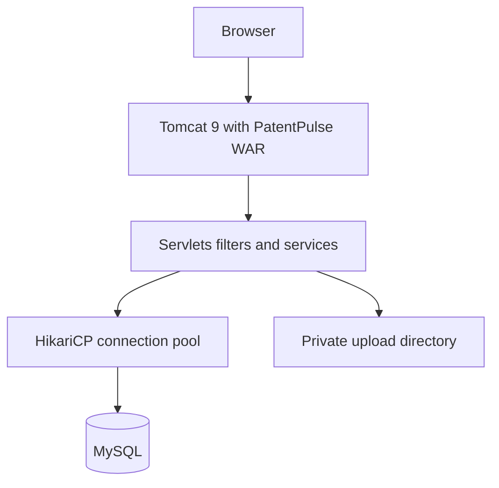


### Authentication Sequence: Login & Session Lifecycle

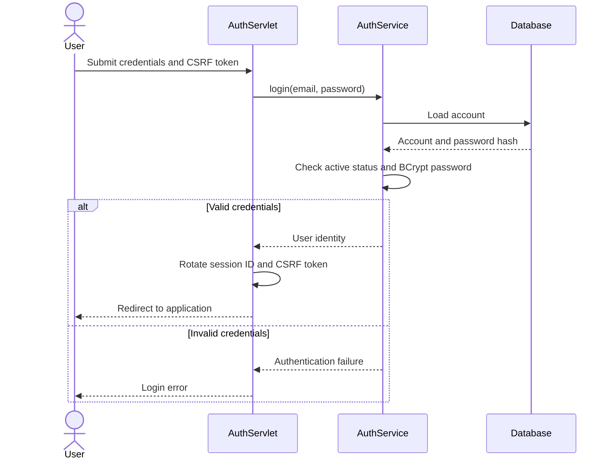

### Activity Diagram: Protected Request Handling

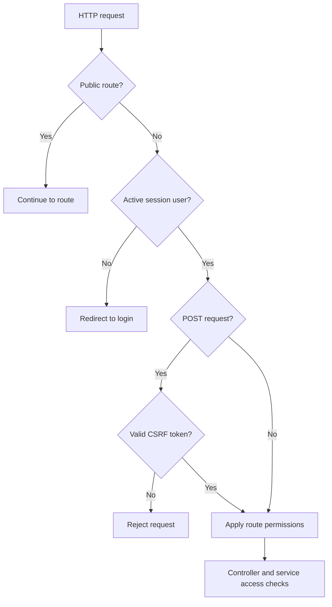

---

## Week 4: Database Design & UI Mock-ups

### Database tables

| Table | Purpose | Important relationship |
|---|---|---|
| `users` | Accounts, password hashes, roles and active status | Owns research; may review or assign |
| `blueprints` | Parent research metadata | Belongs to an owner |
| `document_versions` | File metadata, digest, snapshot and review status | Belongs to a research item |
| `review_assignments` | Reviewer allocation | Connects a reviewer to a version |
| `review_votes` | Decision and feedback | At most one vote per assignment |
| `audit_logs` | Application event records | May reference an actor and a target |

### Entity relationship diagram

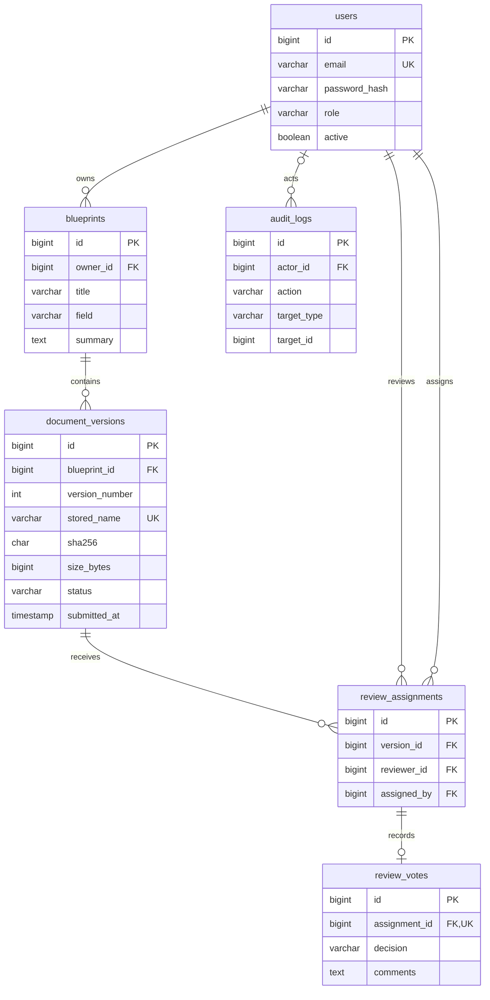

Additional constraints: (blueprint_id, version_number) and (version_id, reviewer_id) are unique. The two-reviewer limit is implemented in the service, not by an ER cardinality constraint. audit_logs.target_id is a polymorphic reference and has no declared foreign key. A receipt is a view of a version.

### Interface screenshots

The following are supplied local-demo screenshots using synthetic research data.

<details>
<summary>Login and registration</summary>

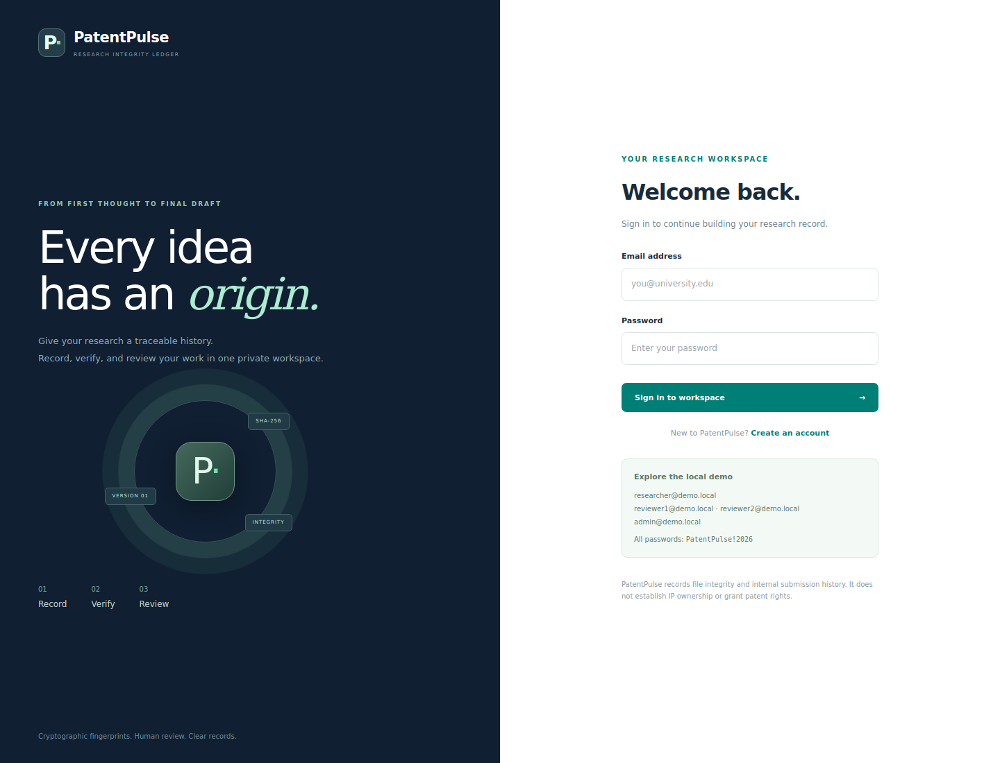

</details>

<details>
<summary>Research dashboard</summary>

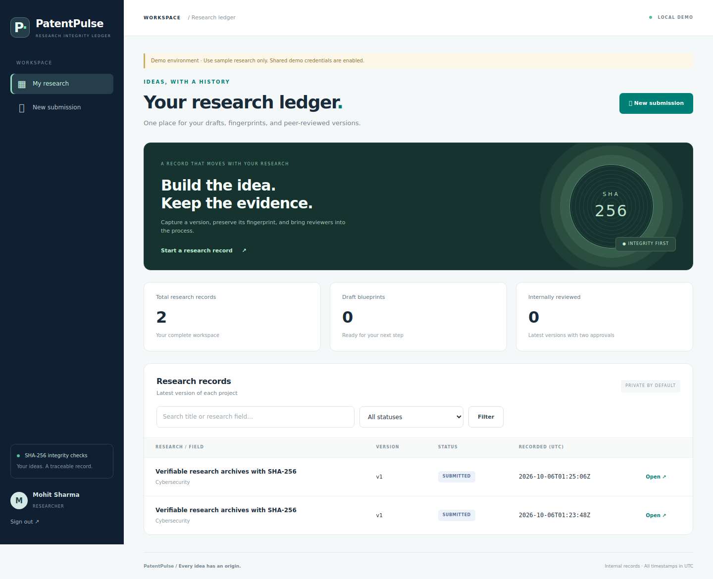

</details>

<details>
<summary>Version details, file verification and history</summary>

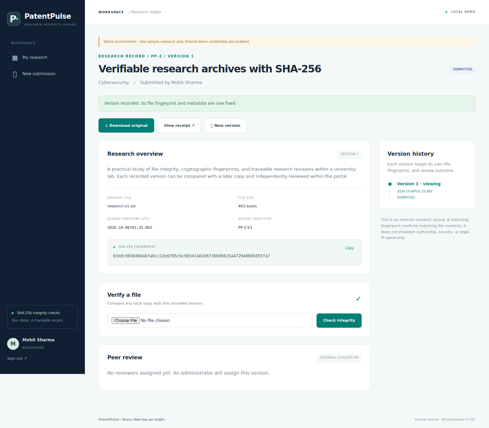

</details>

---

## Week 5: Project Structure & Module 1 Implementation

### Project Directory Structure

```text
PatentPulse/
├── pom.xml
├── config.example.env
├── START-DEMO.bat
├── START-DEMO.sh
├── src/
│   ├── main/
│   │   ├── java/
│   │   │   └── com/
│   │   │       └── patentpulse/
│   │   │           ├── config/
│   │   │           ├── dao/
│   │   │           ├── model/
│   │   │           ├── service/
│   │   │           ├── util/
│   │   │           └── web/
│   │   ├── resources/
│   │   └── webapp/
│   │       ├── assets/
│   │       └── WEB-INF/
│   │           ├── web.xml
│   │           └── views/
│   └── test/
│       └── java/
│           └── com/
│               └── patentpulse/
├── sql/
├── samples/
├── docs/
│   ├── modules/
│   ├── uml/
│   └── screenshots/
└── reports/
    └── excel/
```

### Member 1: Mohit Sharma (Research Drafts, Uploads & Version History)

#### Role & Scope of Work

Saving metadata creates a draft. Submission writes the file and inserts a metadata snapshot with a new version number. Later submissions preserve old snapshots. AppServlet attempts storage cleanup when submission persistence fails.

#### Files and responsibility

```
PatentPulse/
└── src/
    ├── main/
    │   ├── java/
    │   │   └── com/
    │   │       └── patentpulse/
    │   │           ├── service/
    │   │           │   ├── UploadStore.java       (File validation, safe storage and cleanup. Shared with Jay for hashing.)
    │   │           │   └── LedgerService.java     (mine, draft, saveDraft, submit, validate and history. Shared with all five.)
    │   │           └── web/
    │   │               └── AppServlet.java          (Dashboard, editor, draft and submission routes. Shared with Jay, Nitesh and Mann.)
    │   └── webapp/
    │       └── WEB-INF/
    │           └── views/
    │               ├── editor.jsp                   (Draft, upload and submission form.)
    │               ├── dashboard.jsp                (Own research listing, search and status filtering.)
    │               └── document.jsp                 (Research details and version-history section. Shared with Jay and Nitesh.)

```
#### Routes

GET /app/dashboard, GET /app/new, POST /app/draft, POST /app/submit, GET /app/document

#### Data

blueprints and document_versions

#### Shared coordination

Meet supplies the current session user; Jay owns SHA-256 implementation; Nitesh adds review sections; Mann uses version data for receipts. Mohit coordinates root build files, schemas and shared assets.

#### Acceptance checks

1. Create a draft, reopen it and confirm its owner-scoped fields.
2. Submit a supported file and inspect stored metadata.
3. Reject empty, oversized and unsupported files.
4. Submit a second version and confirm the earlier snapshot still exists.
5. Verify another user cannot edit the record.

These are checks to run, not fresh passing results. Use the final merged source and record actual output.

#### Technical Challenges & Handling

1. **File and database consistency:** The controller attempts to remove a saved file if submission persistence fails. Filesystem and database writes are not one atomic transaction.
2. **Preserving previous submissions:** Each upload creates a separate numbered version with its own metadata snapshot.
3. **Shared page ownership:** Research details share document.jsp with verification and review controls; changes must be coordinated with Jay and Nitesh.

#### Implemented Deliverables

- Draft editing and submission interface.
- Own-research dashboard and version history.
- Validated private file storage.

**Module documentation:** [Read Mohit Sharma’s guide](docs/modules/README_Mohit.md).

---

## Week 6: Module 2 & Module 3 Implementation

### Member 2: Meet (Authentication, Sessions & Access Control)

#### Role & Scope of Work

Registration forces RESEARCHER. Registered passwords use BCrypt cost 12. Login rotates session ID and CSRF token. Sessions expire after 30 minutes. The filter refreshes account role and active status on requests.

#### Files and responsibility

```
PatentPulse/
└── src/
    ├── main/
    │   ├── java/
    │   │   └── com/
    │   │       └── patentpulse/
    │   │           ├── model/
    │   │           │   └── User.java                    (Session identity and role helpers.)
    │   │           ├── service/
    │   │           │   ├── AuthService.java             (Account validation, BCrypt and active-user lookup.)
    │   │           │   └── LedgerService.java           (Coordinate service-level role and ownership checks with all owners.)
    │   │           └── web/
    │   │               ├── AuthServlet.java             (Login, registration, logout, session rotation and session-scoped delay.)
    │   │               └── SecurityFilter.java          (Route checks, CSRF, response headers and current-account refresh.)
    │   └── webapp/
    │       └── WEB-INF/
    │           ├── views/
    │           │   └── auth.jsp                     (Login and registration UI.)
    │           └── csrf.jspf                        (CSRF hidden-field fragment.)
```

#### Routes

GET/POST /login, GET/POST /register, POST /logout; filter mapped to /*

#### Data

users, shared with Mann

#### Shared coordination

Coordinate users-table fields and account-state changes with Mann. Every module still needs per-record service authorisation. The one-minute delay after five failures is session-scoped, not account-wide.

#### Acceptance checks

1. Register normally and attempt to submit an elevated role.
2. Check duplicate email and invalid credentials.
3. Check login/logout and protected access after logout.
4. Send a POST without the CSRF token.
5. Deactivate an account through admin and inspect its later access.

These are checks to run, not fresh passing results. Use the final merged source and record actual output.

#### Technical Challenges & Handling

1. **Session fixation:** Successful login rotates the session identifier and refreshes the CSRF token.
2. **Changed account permissions:** The filter refreshes the current account so role and active-status changes affect subsequent requests.
3. **Unauthorised operations:** Route-level checks are combined with ownership and assignment checks in service operations.

#### Implemented Deliverables

- Login, registration and logout interface.
- BCrypt password handling and session identity.
- CSRF and protected-route checks.

**Module documentation:** [Read Meet’s guide](docs/modules/README_Meet.md).

### Member 3: Jay (SHA-256 Verification & Downloads)

#### Role & Scope of Work

UploadStore hashes a stored submission. Verification hashes a separate candidate stream and compares it to the selected version. Download checks authorisation and file existence, then streams the stored bytes. It does not automatically rehash the stored file.

#### Files and responsibility
```
PatentPulse/
└── src/
    ├── main/
    │   ├── java/
    │   │   └── com/
    │   │       └── patentpulse/
    │   │           ├── service/
    │   │           │   ├── LedgerService.java           (verify and the stored-hash comparison. Shared with all five.)
    │   │           │   └── UploadStore.java             (Upload-time hash integration, shared with Mohit.)
    │   │           ├── util/
    │   │           │   └── Hashing.java                 (Streaming SHA-256 utility.)
    │   │           └── web/
    │   │               ├── AppServlet.java              (POST /verify handling, shared with Mohit, Nitesh and Mann.)
    │   │               └── FileServlet.java             (Authorised attachment download.)
    │   └── webapp/
    │       └── WEB-INF/
    │           └── views/
    │               └── document.jsp                 (Hash display, verification result and download link, shared with Mohit and Nitesh.)
    └── test/
        └── java/
            └── com/
                └── patentpulse/
                    └── HashingTest.java             (Known vectors, changed bytes, empty stream and read boundaries.)
```

#### Routes

POST /app/verify and GET /file?id=<version-id>

#### Data

document_versions.sha256, stored_name, original_name and size_bytes; verification audit events

#### Shared coordination

Coordinate storage and upload cleanup with Mohit, access checks with Meet and verification audit records with Mann. Hashing is not encryption or legal proof. Do not claim automatic corrupted-download blocking without implementing and testing it.

#### Acceptance checks

1. Run HashingTest and retain observed results.
2. Compare the original sample and expect MATCH.
3. Compare the altered sample and expect MISMATCH.
4. Check that unauthorised version identifiers cannot be downloaded.
5. Check missing stored-file handling.

These are checks to run, not fresh passing results. Use the final merged source and record actual output.

#### Technical Challenges & Handling

1. **Processing file contents:** Hashing reads a stream rather than requiring the complete document in memory.
2. **Explaining verification:** A matching digest indicates matching candidate bytes against the stored digest; it does not establish patent rights or authorship.
3. **Download access:** FileServlet checks access before serving bytes. Automatic rehashing of stored files during download is not implemented.

#### Implemented Deliverables

- SHA-256 utility and test cases.
- Candidate-file comparison with match/mismatch results.
- Authorised downloads.

**Module documentation:** [Read Jay’s guide](docs/modules/README_Jay.md).

---

## Week 7: Module 4 Implementation

### Member 4: Nitesh (Reviewer Assignments, Decisions & Feedback)

#### Role & Scope of Work

Admins assign up to two distinct active reviewers. Self-review is rejected. Each assignment accepts one vote. Any rejection closes the version as NEEDS_REVISION; two approvals produce INTERNALLY_REVIEWED. Comments require 10–3000 characters under the source validation rules.

#### Files and responsibility

```
PatentPulse/
└── src/
    ├── main/
    │   ├── java/
    │   │   └── com/
    │   │       └── patentpulse/
    │   │           ├── service/
    │   │           │   ├── ReviewPolicy.java            (Status calculation and terminal-state helper.)
    │   │           │   └── LedgerService.java           (reviews, queue, reviewers, assign, lockVersion and vote. Shared with all five.)
    │   │           └── web/
    │   │               └── AppServlet.java              (Queue, assignment and decision routes, shared with Mohit, Jay and Mann.)
    │   └── webapp/
    │       └── WEB-INF/
    │           ├── views/
    │           │   ├── queue.jsp                    (Reviewer and administrator queue.)
    │           │   └── document.jsp                 (Assignment controls, decision form and feedback. Shared with Mohit and Jay.)
    └── test/
        └── java/
            └── com/
                └── patentpulse/
                    └── ReviewPolicyTest.java        (Threshold, rejection and terminal-state tests.)

```
#### Routes

GET /app/review, GET /app/admin/queue, POST /app/admin/assign, POST /app/review/vote

#### Data

review_assignments, review_votes and document_versions.status

#### Shared coordination

Although admins use assignment controls, this development feature belongs to Nitesh. Coordinate version IDs with Mohit, permission checks with Meet and audit events with Mann.

#### Acceptance checks

1. Reject duplicate, third and self-review assignments.
2. Confirm one approval leaves IN_REVIEW.
3. Confirm two approvals finish the review.
4. Confirm any rejection requires a new revision.
5. Reject duplicate votes and decisions on terminal versions.

These are checks to run, not fresh passing results. Use the final merged source and record actual output.

#### Technical Challenges & Handling

1. **Conflicting decisions:** ReviewPolicy applies any rejection before the two-approval outcome.
2. **Duplicate and self-review:** Assignment validation rejects repeated reviewers and self-review; each assignment permits one decision.
3. **Closed review versions:** Terminal versions cannot receive further decisions; a revision must be submitted as a new version.

#### Implemented Deliverables

- Reviewer queue and assignment controls.
- Decision and feedback processing.
- Review-status policy and unit tests.

**Module documentation:** [Read Nitesh’s guide](docs/modules/README_Nitesh.md).

---

## Week 8: Module 5 Implementation & Summary

### Member 5: Mann Jain (Administration, Audit Logs & Receipts)

#### Role & Scope of Work

Admins can update non-admin researcher/reviewer accounts. Existing admin accounts cannot be changed through this page. Unfinished active reviewer assignments block deactivation or demotion. The audit view shows the latest 200 events. Receipts read version data and have no separate table.

#### Files and responsibility

| Project path | Responsibility |
|---|---|
| `src/main/webapp/WEB-INF/views/users.jsp` | Role and active-status administration UI. |
| `src/main/webapp/WEB-INF/views/audit.jsp` | Latest audit event display. |
| `src/main/webapp/WEB-INF/views/receipt.jsp` | Printable submission receipt. |
| `src/main/java/com/patentpulse/service/LedgerService.java` | users, changeUser and audit. Shared with all five. |
| `src/main/java/com/patentpulse/dao/Database.java` | Audit insertion and shared JDBC helpers. Coordinate all schema impacts. |
| `src/main/java/com/patentpulse/web/AppServlet.java` | User administration, audit and receipt routes, shared with Mohit, Jay and Nitesh. |

#### Routes

GET /app/admin/users, POST /app/admin/user, GET /app/admin/audit, GET /app/receipt

#### Data

users and audit_logs; read document_versions and blueprints for receipts

#### Shared coordination

Coordinate account semantics with Meet, receipt version data with Mohit and review-related events with Nitesh. Receipts are unsigned and do not grant patent rights. Database operators can alter audit data; append-only or tamper-proof storage is not implemented.

#### Acceptance checks

1. Reject admin routes for ordinary users.
2. Change an eligible user role and active flag.
3. Reject edits to admin accounts.
4. Check unfinished-reviewer protection.
5. Inspect audit ordering and authorised receipt access.

These are checks to run, not fresh passing results. Use the final merged source and record actual output.

#### Technical Challenges & Handling

1. **Protected administration accounts:** The administration page does not allow editing existing admin accounts.
2. **Outstanding reviewer work:** Unfinished reviewer assignments block deactivation or demotion.
3. **Interpreting receipts and audit trails:** Receipts display version data; ordinary database audit records are not an independently tamper-proof ledger.

#### Implemented Deliverables

- Account role and status management.
- Audit event listing.
- Printable version receipt.

**Module documentation:** [Read Mann Jain’s guide](docs/modules/README_Mann.md).

### Summary of Module Distribution

| Module | Member | Primary Focus | Guide |
| :--- | :--- | :--- | :--- |
| Module 1 | Mohit Sharma | Research Drafts, Uploads & Version History | [Module 1](docs/modules/README_Mohit.md) |
| Module 2 | Meet | Authentication, Sessions & Access Control | [Module 2](docs/modules/README_Meet.md) |
| Module 3 | Jay | SHA-256 Verification & Downloads | [Module 3](docs/modules/README_Jay.md) |
| Module 4 | Nitesh | Reviewer Assignments, Decisions & Feedback | [Module 4](docs/modules/README_Nitesh.md) |
| Module 5 | Mann Jain | Administration, Audit Logs & Receipts | [Module 5](docs/modules/README_Mann.md) |

### Shared-File Coordination

| Shared file | Members coordinating changes |
|---|---|
| `LedgerService.java` | Mohit, Meet, Jay, Nitesh and Mann |
| `AppServlet.java` | Mohit, Jay, Nitesh and Mann |
| `document.jsp` | Mohit, Jay and Nitesh |
| `UploadStore.java` | Mohit and Jay |
| `Database.java` and schema files | Mann and members affected by database changes |

Shared means several modules use sections of one file. It does not mean each member should upload a separate full copy over the others' changes.

---

## Week 9: System Integration & End-to-End (E2E) Testing

### Available test evidence

The integration baseline was checked on **13 October 2026** with **11 tests passing** using embedded Tomcat and H2. See [integration validation](docs/INTEGRATION-VALIDATION.md). Real MySQL and external Tomcat deployment checks remain to be confirmed.

| Suite | Test methods | Scope |
|---|---:|---|
| `HashingTest` | 4 | Digest behaviour and stream cases |
| `ReviewPolicyTest` | 4 | Approval, rejection and terminal-state rules |
| `WorkflowTest` | 3 | Connected HTTP/JSP application workflows |

### Integration checks by member

| Member | Checks to run on the final branch |
|---|---|
| Mohit | Draft persistence, invalid uploads and separate version snapshots |
| Meet | Registration, login/logout, CSRF and unauthorised route access |
| Jay | Original-file match, changed-file mismatch and authorised downloads |
| Nitesh | Duplicate/self assignments, two approvals, rejection and repeat-vote blocking |
| Mann | Account restrictions, audit events and version receipts |

### Integration risks and handling

| Risk to check | Handling |
|---|---|
| Conflicting edits in shared files | Update from main, review diffs and merge through pull requests. |
| Database failure after file storage | Controller attempts file cleanup; crash recovery requires separate operational handling. |
| Incompatible servlet container | Use the supplied javax.servlet baseline with Tomcat 9. |
| Incorrect database configuration | Set actual environment variables; the application does not automatically load `.env`. |
| Demo succeeds but deployment differs | Repeat checks on MySQL and external Tomcat. |

These are risks and checks, not claims of incidents the team experienced.

```sh
mvn clean verify
```

Record the tested commit, Java/Maven versions and actual build output. No latency benchmark, load-test result or independent security audit has been supplied.
### Member 1: Mohit Sharma — Integration Responsibilities

#### Integration & Testing Role

Connect and validate research drafts, uploads & version history against the shared application.

#### Work & Scope

- Validate draft editing and submission interface.
- Validate own-research dashboard and version history.
- Validate validated private file storage.

#### Integration Risks & Handling

- **File and database consistency:** The controller attempts to remove a saved file if submission persistence fails. Filesystem and database writes are not one atomic transaction.
- **Preserving previous submissions:** Each upload creates a separate numbered version with its own metadata snapshot.
- **Shared page ownership:** Research details share document.jsp with verification and review controls; changes must be coordinated with Jay and Nitesh.

#### Evidence and Remaining Checks

Use the shared integration report for recorded automated results. Member-specific manual checks require their own observed result; module ownership does not establish who executed a test.

### Member 2: Meet — Integration Responsibilities

#### Integration & Testing Role

Connect and validate authentication, sessions & access control against the shared application.

#### Work & Scope

- Validate login, registration and logout interface.
- Validate bcrypt password handling and session identity.
- Validate csrf and protected-route checks.

#### Integration Risks & Handling

- **Session fixation:** Successful login rotates the session identifier and refreshes the CSRF token.
- **Changed account permissions:** The filter refreshes the current account so role and active-status changes affect subsequent requests.
- **Unauthorised operations:** Route-level checks are combined with ownership and assignment checks in service operations.

#### Evidence and Remaining Checks

Use the shared integration report for recorded automated results. Member-specific manual checks require their own observed result; module ownership does not establish who executed a test.

### Member 3: Jay — Integration Responsibilities

#### Integration & Testing Role

Connect and validate sha-256 verification & downloads against the shared application.

#### Work & Scope

- Validate sha-256 utility and test cases.
- Validate candidate-file comparison with match/mismatch results.
- Validate authorised downloads.

#### Integration Risks & Handling

- **Processing file contents:** Hashing reads a stream rather than requiring the complete document in memory.
- **Explaining verification:** A matching digest indicates matching candidate bytes against the stored digest; it does not establish patent rights or authorship.
- **Download access:** FileServlet checks access before serving bytes. Automatic rehashing of stored files during download is not implemented.

#### Evidence and Remaining Checks

Use the shared integration report for recorded automated results. Member-specific manual checks require their own observed result; module ownership does not establish who executed a test.

### Member 4: Nitesh — Integration Responsibilities

#### Integration & Testing Role

Connect and validate reviewer assignments, decisions & feedback against the shared application.

#### Work & Scope

- Validate reviewer queue and assignment controls.
- Validate decision and feedback processing.
- Validate review-status policy and unit tests.

#### Integration Risks & Handling

- **Conflicting decisions:** ReviewPolicy applies any rejection before the two-approval outcome.
- **Duplicate and self-review:** Assignment validation rejects repeated reviewers and self-review; each assignment permits one decision.
- **Closed review versions:** Terminal versions cannot receive further decisions; a revision must be submitted as a new version.

#### Evidence and Remaining Checks

Use the shared integration report for recorded automated results. Member-specific manual checks require their own observed result; module ownership does not establish who executed a test.

### Member 5: Mann Jain — Integration Responsibilities

#### Integration & Testing Role

Connect and validate administration, audit logs & receipts against the shared application.

#### Work & Scope

- Validate account role and status management.
- Validate audit event listing.
- Validate printable version receipt.

#### Integration Risks & Handling

- **Protected administration accounts:** The administration page does not allow editing existing admin accounts.
- **Outstanding reviewer work:** Unfinished reviewer assignments block deactivation or demotion.
- **Interpreting receipts and audit trails:** Receipts display version data; ordinary database audit records are not an independently tamper-proof ledger.

#### Evidence and Remaining Checks

Use the shared integration report for recorded automated results. Member-specific manual checks require their own observed result; module ownership does not establish who executed a test.


---

## Week 10: Final System Evaluation, Deliverables & Project Submission

### Project Deliverables & Artifacts

| Deliverable | Resource | Status |
|---|---|---|
| Project report | [Word document](https://docs.google.com/document/d/1VGnz2tlHKocOxwPtAJICDm8wZwZ3FXKU/edit?usp=sharing&ouid=116020988422796059772&rtpof=true&sd=true) | Prepared; team details to complete |
| Research paper | [Paper draft](https://drive.google.com/file/d/1-I-SIa14MsZsjQuyYNhEftY0Hepep2zP/view?usp=sharing) | Unpublished design and implementation draft |
| SRS | [Requirements](https://drive.google.com/file/d/12Y_sHfc7zVybGAvwn7ySOf90QEhWdJwl/view?usp=sharing) | Prepared |
| Presentation | [13-slide PPT](reports/PatentPulse_Presentation.pptx) | Prepared |
| Weekly report | [Weeks 1–12](https://drive.google.com/file/d/1qH0LV0P5n1XUYl7Ad2BPkcK9Jf4CR65F/view?usp=sharing) | Prepared |
| Demo video | [Recording script](docs/DEMO_VIDEO_SCRIPT.md) | Recording pending |

The linked documents and screenshots use the existing PatentPulse repository layout. Save this file as README.md at the repository root.

### Suggested demonstration

1. Log in and save a research draft.
2. Submit a sample file and show its version, digest and receipt.
3. Compare the original file, then an altered file.
4. Assign reviewers and demonstrate a review decision.
5. Submit a revised version and show preserved history.
6. Show permitted account management and audit events.

---

## Quick Start

Clone the existing repository:

```sh
git clone https://github.com/mohitsharma1305/PatentPulse.git
cd PatentPulse
```

Run the following commands from the repository root containing `pom.xml`.

Prerequisites: JDK 17, Maven and the supplied project source. Run commands from the directory containing `pom.xml`.

Windows demo:
```bat
java -version
mvn -version
START-DEMO.bat
```

Linux/macOS demo:
```sh
chmod +x START-DEMO.sh
./START-DEMO.sh
```

Open `http://localhost:8080/patentpulse`. The initial run downloads dependencies. Keep the terminal open and stop with Ctrl+C. 

## Build and database deployment

```sh
mvn clean verify
```

The WAR is `target/patentpulse.war`. Use a compatible Tomcat 9 installation for the supplied `javax.servlet` application. MySQL setup is in `sql/create-database.sql` and `sql/schema.sql`. Set actual environment variables based on `config.example.env`: `DB_URL`, `DB_USER`, `DB_PASSWORD`, `UPLOAD_DIR`, `INIT_SCHEMA`, `DEMO_MODE` and the first-admin bootstrap settings. The application does not automatically read `.env` files.

Configure a private upload directory and bootstrap the first admin. Remove bootstrap credentials afterwards. Review dependency patch levels and deployment controls before public hosting. The archive's dependency versions are a reproducibility baseline, not a claim that they are the newest secure releases.
## Team Git Workflow

Pull current main before starting a branch. Stage exact assigned files, describe actual changes in the commit, and open a pull request. Coordinate changes in `LedgerService.java`, `AppServlet.java`, `document.jsp`, `UploadStore.java` and `Database.java`. Member-name folders in the earlier distribution pack are wrappers, not repository directories.

Do not commit local database files, uploads, secrets, `target/` or a Maven installation. Rebuild the WAR after source changes.

## Scope & Current Limitations

- Verification compares an uploaded candidate with a saved digest. Downloads do not automatically rehash the stored file.
- SHA-256 does not establish originality, patentability or ownership.
- Receipts are unsigned application records; there is no independent timestamp service.
- Upload checks do not include antivirus scanning.
- Failed-login throttling is session-scoped.
- Real MySQL deployment checks and the demo video remain to be verified or completed.
