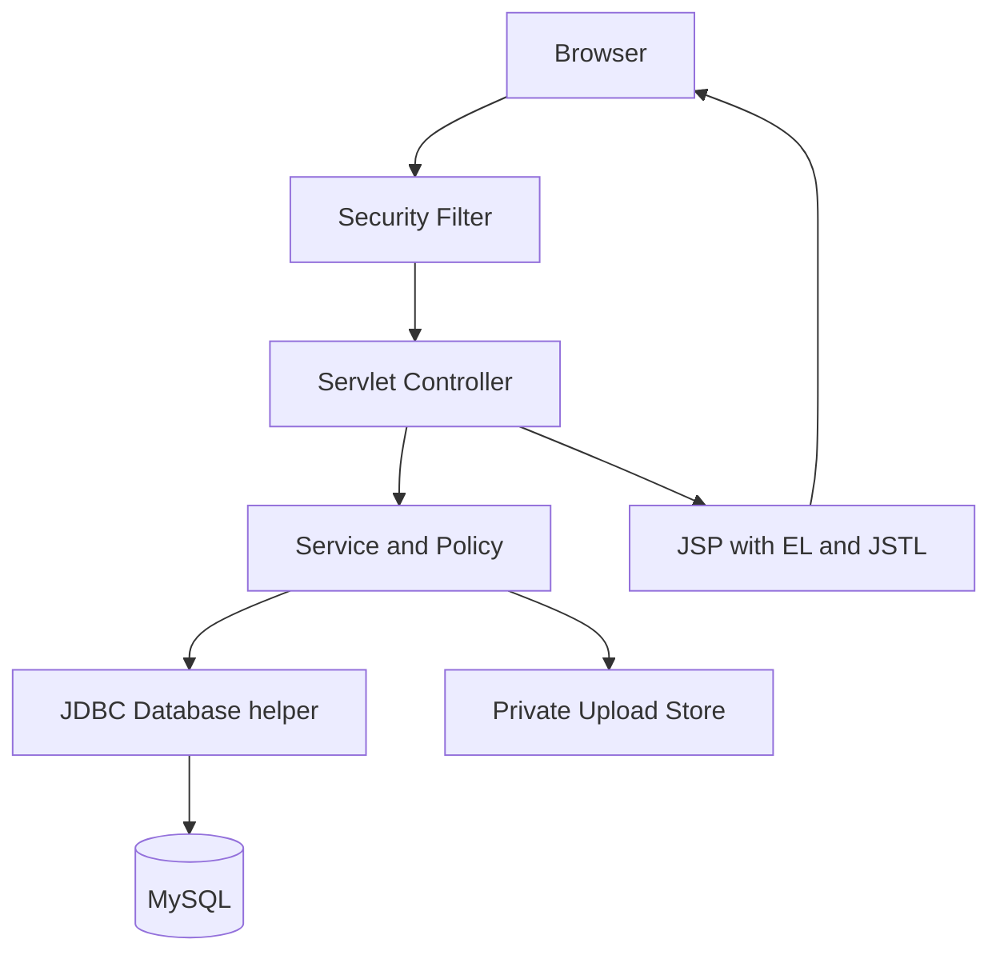
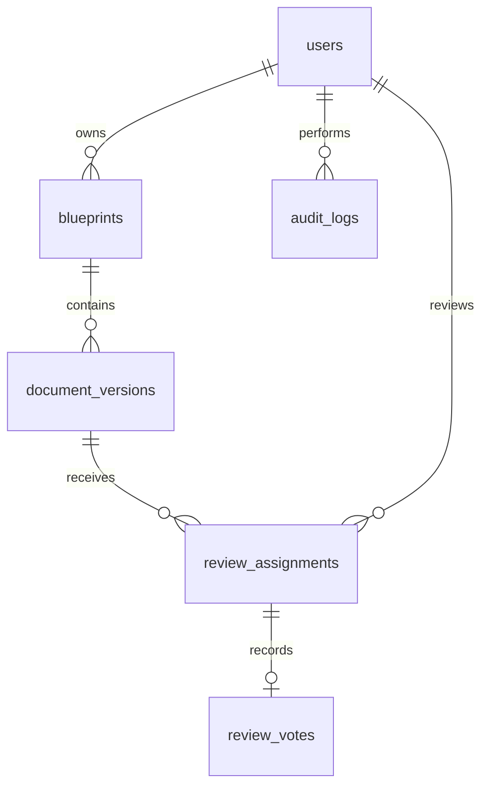
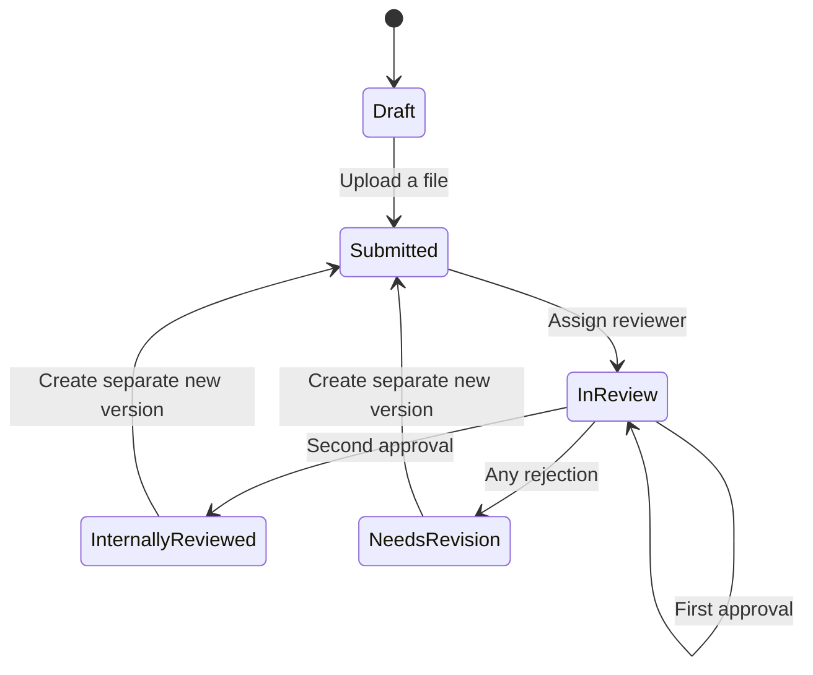

# Architecture and scope

## Use case

A university researcher needs an organized, private record of research versions and internal evaluations. PatentPulse binds each submitted version to its exact file bytes, records an internal timestamp, and provides a repeatable integrity comparison and reviewer workflow.

## Request path

- `SecurityFilter`: security headers, current-account refresh, session checks, role gates, CSRF checks, friendly errors.
- `AuthServlet`: registration, login, session rotation, logout.
- `AppServlet`: dashboard, drafts, versions, comparisons, reviews, user management and audit pages.
- `FileServlet`: authorized attachment download; no public static upload directory.
- `LedgerService`: transactional business rules and object-level authorization.
- `Database`: prepared JDBC operations, explicit commit/rollback, map-shaped read models.
- `UploadStore`: size/extension/content sanity checks, UUID filenames, private paths and streamed hashing.
- `AppContext`: initializes the HikariCP pool and services; closes the pool at shutdown.
- JSP files live beneath `WEB-INF` and cannot be requested directly.

## Login and logout lifecycle

Login and registration are submitted by POST forms with a CSRF token. The authentication service normalizes email addresses and verifies password hashes with BCrypt; after a successful login, the servlet rotates the session ID, issues a fresh CSRF token, clears failed-login cooldown state and redirects to the dashboard. Failed login attempts receive a generic message so the response does not disclose whether an email address is registered.

Logout is also POST-only and protected by the same CSRF check. It invalidates the authenticated session before redirecting to the login page, which displays a signed-out confirmation. A GET request to `/logout` is rejected, so following a link cannot accidentally end a user's session.

## Database relationships

`review_assignments.assigned_by` additionally references the assigning admin. Version rows retain title, field and summary snapshots, so updating the blueprint's current metadata does not change historical records. Unique `(blueprint_id, version_number)`, `(version_id, reviewer_id)`, and `assignment_id` constraints enforce version numbering, distinct assignments and one vote per assignment.

## Lifecycle

New versions are separate rows; the old version retains its terminal status. Users can also create a new version while an older version is under review. Each version has its own assignments and outcome. A rejection ends review immediately; pending reviewers cannot vote on that closed version. At most two reviewers are assigned. There is no assignment-replacement feature in this mini-project; active pending reviewers cannot be demoted or disabled until their active reviews finish.

## Transaction and concurrency design

- Creating a submitted version writes the blueprint (when new), version metadata, SHA-256, database timestamp and audit event in one JDBC transaction.
- Existing-blueprint submissions lock the blueprint row before allocating `MAX(version_number)+1`.
- Assignment and vote operations lock the version row, serializing review changes.
- Duplicate reviewer assignments and repeat votes are rejected by service checks plus unique database constraints.
- The uploaded file is persisted before the database transaction. If the transaction fails, the controller deletes the new file. Filesystem writes are **not** part of the database transaction; a process crash in between can leave an orphan file. Production maintenance should reconcile unreferenced files after backup/recovery.
- SQL parameters use PreparedStatement. Search parameters are never concatenated into SQL. Map column names and SQL text are application-owned.

## Authorization

| Capability | Researcher | Reviewer | Admin |
|---|---|---|---|
| Create own research | Yes | Yes | Yes |
| View own submissions | Yes | Yes | Yes |
| View another researcher's version | No | Assigned versions only | Yes |
| Review a version | No | Assigned, non-self, open versions | No |
| Assign reviewers | No | No | Yes |
| Change user roles/access | No | No | Yes, non-admin accounts only |
| Read audit events | No | No | Yes |

Reviewer names are hidden from non-admin review lists. This is **not complete blind review**: authors remain visible, comments can reveal identity, and an uploaded document may contain identifying information.

## Integrity boundaries

- SHA-256 checks exact bytes, not semantic similarity or plagiarism.
- A timestamp comes from the server/database clock configured for UTC. It is not independently attested.
- Application code does not overwrite submitted file/metadata snapshots; privileged database or filesystem operators can still alter them.
- Audit records are application-append-only; they are not hash-chained or independently anchored. The runtime SQL account can update rows, so this is not a tamper-proof ledger.
- Internal review assesses the submission; it does not verify scientific correctness, inventorship, novelty or patentability.
- Receipts reflect review status when viewed and are unsigned. Their authenticity cannot be independently established offline.
- Private submission does not itself establish public disclosure or legal prior art.

## Security implemented and deployment limits

Implemented: BCrypt (work factor 12 for new accounts), 10-character minimum and 72-byte maximum passwords, session ID rotation on login, HttpOnly session cookies, 30-minute session timeout, per-session login cooldown, role and record authorization, CSRF tokens on POST actions, output escaping, CSP, no-sniff and frame-denial headers, private file storage, attachment downloads, upload size/type checks and prepared JDBC statements.

The session cooldown is a basic teaching example; a new session bypasses it. Before public deployment, add account/IP-based rate limiting at a trusted gateway, HTTPS, Secure and SameSite session-cookie configuration, dependency updates and scanning, monitoring, backup/recovery, upload malware scanning, and account recovery/email verification. File header/NUL checks are sanity checks, not malware detection. No external scripts/fonts/CDNs are required by the UI.

Use `INIT_SCHEMA=false` with the supplied limited-privilege MySQL account. Automatic schema setup is for local demo or an explicitly authorized account with DDL privileges. Back up database and uploads together. Do not enable `DEMO_MODE` on a real research server.
