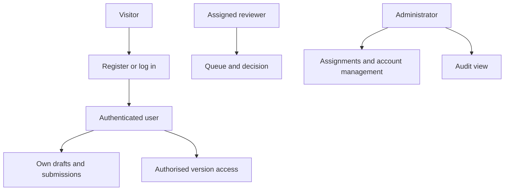
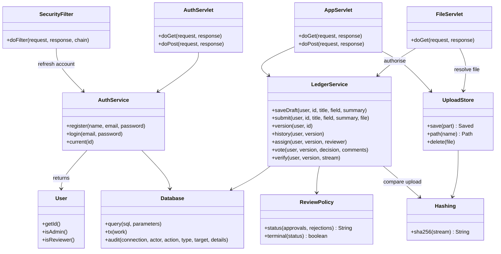
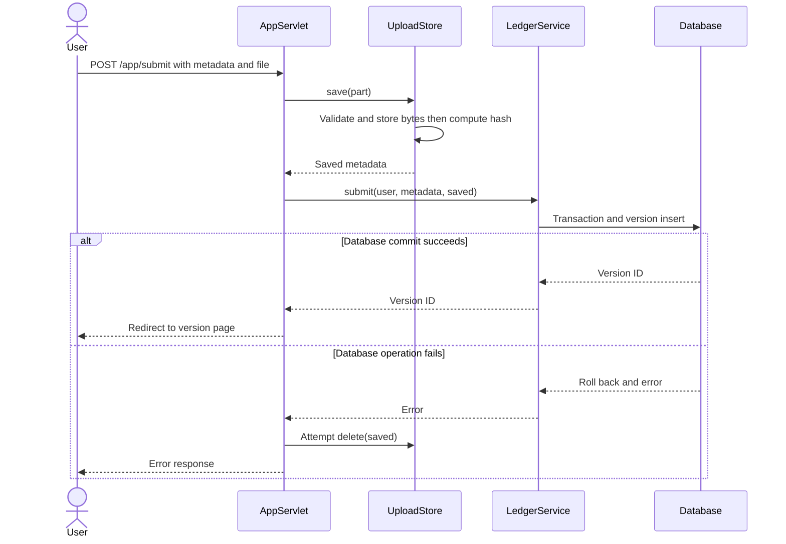
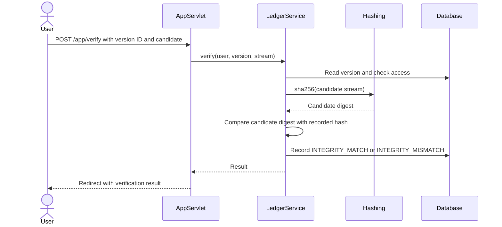
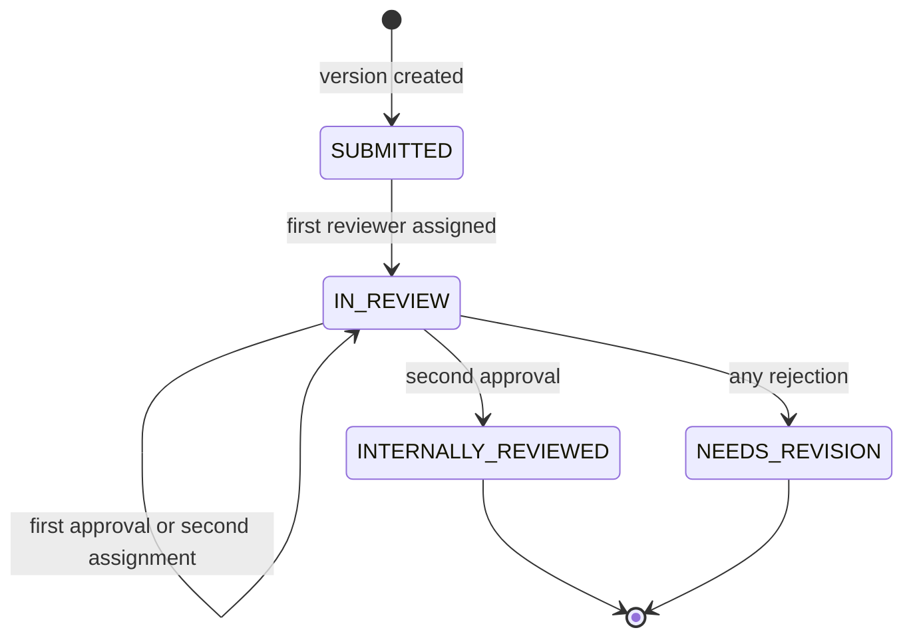
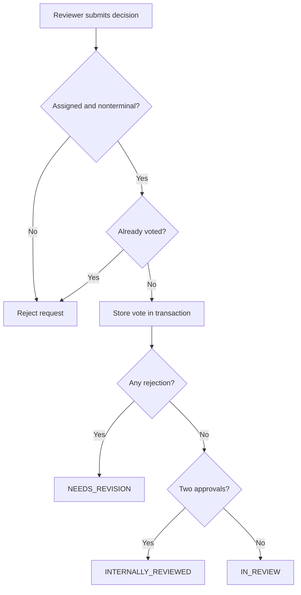
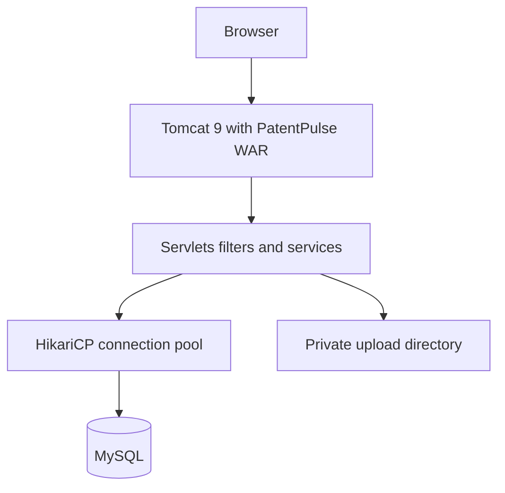
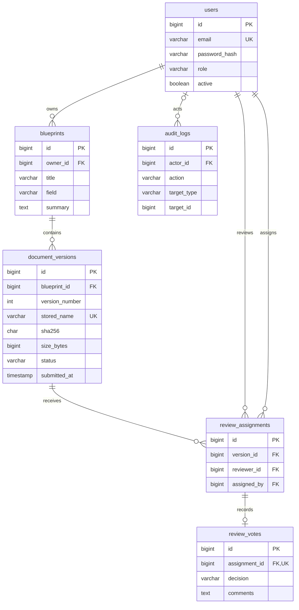

# PatentPulse UML and database design

These diagrams describe the supplied implementation. Mermaid blocks render on GitHub. The formal use-case source is also supplied as [use-cases.puml](use-cases.puml) for PlantUML. Flowcharts below are explanatory architecture/activity views; the class, sequence and state diagrams use Mermaid's UML-oriented notation. The ER diagram is a database design view.

## Use cases

| Actor | Main use cases |
|---|---|
| Visitor | Register, log in |
| Authenticated user | Maintain own drafts, submit versions, list own research |
| Owner, assigned reviewer or admin | View authorised version, compare candidate file, download, view receipt |
| Reviewer | View assigned queue, submit one decision per assignment |
| Admin | Assign reviewers, manage non-admin accounts, inspect audit events |

Current personal research routes accept any authenticated role and remain owner-scoped. Restricting creation to researchers only is not enforced by an additional role check in the supplied baseline.

## Class diagram

Method lists are selective; they do not reproduce every helper or constructor. Persistence records other than User are represented by maps in the Java implementation, not invented entity classes.

## Submission sequence

The filter has authenticated the request and checked the POST token before this sequence begins. File validation failure ends before persistence. Database failure triggers attempted file cleanup.

## Verification sequence

## Version state diagram

Draft describes a parent research item before its first version, and is not stored in document_versions.status. Each new version starts at SUBMITTED. A terminal version never returns to an earlier state.

## Review activity view

## Deployment view

The local demo substitutes embedded Tomcat and H2. Public TLS termination and backup infrastructure are deployment responsibilities and are not supplied as application services.

## Entity relationship diagram

Additional constraints: (blueprint_id, version_number) and (version_id, reviewer_id) are unique. The two-reviewer limit is implemented in the service, not by an ER cardinality constraint. audit_logs.target_id is a polymorphic reference and has no declared foreign key. A receipt is a view of a version.
